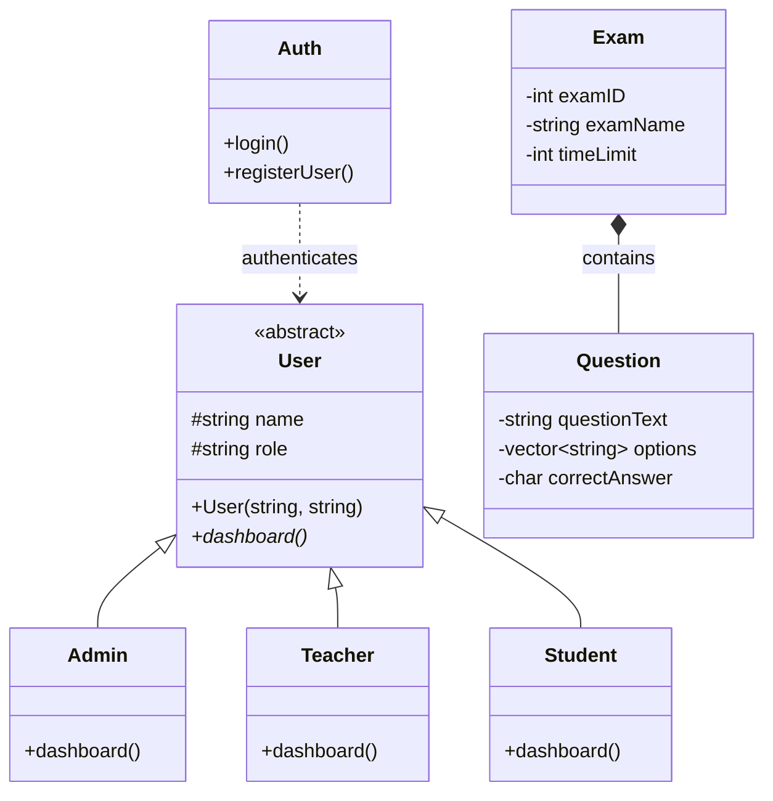

# Online Examination System

<p align="center">
  A console-based examination management system built with C++ and Object-Oriented Programming.
</p>

<p align="center">
  
  
  
</p>

## Overview

The **Smart Online Examination System** is a menu-driven C++ application designed to simplify basic examination management. It provides separate interfaces for administrators, teachers, and students.

Administrators can manage examinations, teachers can create exams and add multiple-choice questions, and students can participate in examinations and view their results.

The project demonstrates practical applications of **Object-Oriented Programming (OOP), file handling, STL, and basic data management** in C++.

## Features

### Authentication
- User login and registration.
- Separate access options for administrators, teachers, and students.
- User information stored in a text file.

### Admin Panel
- View available examinations.
- Edit examination names.
- Delete examinations.
- Clear questions from examinations.

### Teacher Panel
- Create new examinations.
- Set examination names and time limits.
- Add multiple-choice questions.
- Provide four answer options and specify the correct answer.

### Student Panel
- View available examinations.
- Attempt multiple-choice examinations.
- Receive automatically calculated scores.
- View pass/fail status.
- Access a leaderboard based on scores.

### File Handling
- Store user information in `users.txt`.
- Save examination information in `exams.txt`.
- Load saved examination data when supported by the program flow.

## Tech Stack

| Technology | Purpose |
|---|---|
| C++17 | Core programming language |
| OOP | Class-based application design |
| STL | Data structures and sorting |
| File Handling | Persistent storage using text files |
| VS Code | Development environment |
| GCC / MinGW | Compilation |

## System Architecture

The application uses a **menu-driven, object-oriented architecture**. Authentication, user roles, examination management, evaluation, and file storage work together to provide the core functionality.

```text
                  ┌────────────────────────┐
                  │       Main Menu        │
                  │ Login / Register / Exit│
                  └────────────┬───────────┘
                               │
                  ┌────────────▼───────────┐
                  │  Authentication (Auth) │
                  │   Login & Registration │
                  └────────────┬───────────┘
                               │
                  ┌────────────▼───────────┐
                  │      User Module       │
                  │  Abstract User Class   │
                  └────────────┬───────────┘
                               │
              ┌────────────────┼────────────────┐
              │                │                │
       ┌──────▼──────┐ ┌───────▼─────┐ ┌────────▼─────┐
       │    Admin    │ │   Teacher   │ │   Student    │
       │             │ │             │ │              │
       │ Manage Exams│ │ Create Exams│ │ Take Exams   │
       │ Edit/Delete │ │ Add Questions│ │ View Results │
       └──────┬──────┘ └───────┬─────┘ └────────┬─────┘
              │                │                │
              └────────────────┼────────────────┘
                               │
                  ┌────────────▼───────────┐
                  │  Examination Module    │
                  │ Exam & Question Classes│
                  │ Scoring and Evaluation │
                  └────────────┬───────────┘
                               │
                  ┌────────────▼───────────┐
                  │      File Storage      │
                  │ users.txt / exams.txt  │
                  └────────────────────────┘
```

### Main Components

- **Main Menu:** Provides the application's primary navigation.
- **Authentication Module:** Handles login and registration.
- **User Module:** Organizes user roles through object-oriented classes.
- **Admin Module:** Supports examination management.
- **Teacher Module:** Handles examination creation and question management.
- **Student Module:** Supports examination participation and result viewing.
- **Examination Module:** Manages exams, questions, and answer evaluation.
- **File Storage:** Stores user and examination information in text files.

## System Workflow

```text
              ┌──────────────────┐
              │   Start Program  │
              └─────────┬────────┘
                        │
              ┌─────────▼────────┐
              │    Main Menu     │
              └─────────┬────────┘
                        │
              ┌─────────▼────────┐
              │ Select an Option │
              └─────────┬────────┘
                        │
          ┌─────────────┼─────────────┐
          │             │             │
     ┌────▼────┐  ┌─────▼────┐  ┌─────▼────┐
     │  Admin  │  │ Teacher  │  │ Student  │
     │  Login  │  │  Login   │  │  Login   │
     └────┬────┘  └─────┬────┘  └─────┬────┘
          │             │             │
     ┌────▼────┐  ┌─────▼────┐  ┌─────▼────┐
     │ Manage  │  │  Create  │  │ View and │
     │ Exams   │  │ Exams &  │  │ Take Exam│
     │         │  │ Questions│  │          │
     └────┬────┘  └─────┬────┘  └─────┬────┘
          │             │             │
          │       ┌─────▼────┐  ┌─────▼────┐
          │       │ Save Exam│  │ Evaluate │
          │       │   Data   │  │ Answers  │
          │       └─────┬────┘  └─────┬────┘
          │             │             │
          └─────────────┴─────────────┘
                        │
              ┌─────────▼────────┐
              │ Return to Menu   │
              │ or Exit Program  │
              └──────────────────┘
```

### Workflow Explanation

1. **Start:** The application starts and initializes its required data.
2. **Authentication:** Users log in or register through the main menu.
3. **Role-Based Dashboard:** The application opens the relevant dashboard after login.
4. **Exam Management:** Administrators manage existing examinations.
5. **Exam Creation:** Teachers create exams and add multiple-choice questions.
6. **Exam Participation:** Students select an exam and submit their answers.
7. **Evaluation:** The application compares submitted answers with correct answers and calculates the score.
8. **Result Display:** Students receive their scores and pass/fail status.
9. **Data Storage:** Examination data is saved to a text file through the application's file-handling functions.

## OOP Class Diagram

The system uses object-oriented design to organize users, examinations, questions, and authentication.



### Class Responsibilities

| Class | Responsibility |
|---|---|
| `User` | Defines common user information and a virtual dashboard interface. |
| `Admin` | Provides administrator functionality. |
| `Teacher` | Provides teacher functionality for creating examinations and questions. |
| `Student` | Provides student functionality for attempting examinations. |
| `Exam` | Stores examination information and questions. |
| `Question` | Stores question text, answer options, and the correct answer. |
| `Auth` | Handles user authentication and registration. |

### OOP Concepts

- **Abstraction:** Defines a common interface through the abstract `User` class.
- **Inheritance:** Organizes specialized user roles under the base `User` class.
- **Encapsulation:** Groups related data and functionality into classes.
- **Polymorphism:** Allows derived user classes to provide their own `dashboard()` implementations.
- **Composition:** Represents an examination as containing its questions.

## Project Structure

```text
Online-Examination-System/
│
├── code.cpp
├── a.exe
├── README.md
├── users.txt
├── exams.txt
└── certificate.txt
```

| File | Description |
|---|---|
| `code.cpp` | Main C++ source code. |
| `a.exe` | Compiled Windows executable. |
| `README.md` | Project documentation. |
| `users.txt` | User account data. |
| `exams.txt` | Saved examination data. |
| `certificate.txt` | Additional project file; its current functionality depends on the implementation. |

## Getting Started

### Prerequisites

To compile the source code, install:

- A C++ compiler supporting C++17, such as GCC/MinGW.
- Visual Studio Code or another C++ development environment (optional).

### Option 1: Run the Existing Executable on Windows

1. Download or clone the repository.
2. Open the project folder.
3. Double-click `a.exe`, or run it from Command Prompt:

```bash
a.exe
```

Run the command from the directory containing the executable.

### Option 2: Compile from Source

Open a terminal in the project directory and execute:

```bash
g++ -std=c++17 code.cpp -o a.exe
```

Then run:

```bash
a.exe
```

**Note:** The supplied `a.exe` is a Windows executable. On Linux or macOS, compile `code.cpp` with a compatible compiler to create a native executable.

## How to Use

1. Launch the application.
2. Select an option from the main menu.
3. Log in using an appropriate account or register.
4. Open the dashboard corresponding to the account role.
5. Follow the menu prompts to manage, create, or attempt examinations.
6. Review the displayed examination results.

The exact login credentials and available accounts depend on the contents of `users.txt` and the authentication logic in the source code.

## Scoring System

The application evaluates multiple-choice answers by comparing each submitted answer with the correct answer.

- Correct answers contribute to the total score.
- The score is calculated from the number of correct answers.
- The passing threshold is 40% in the current implementation.
- The leaderboard sorts results by score.

The examination time limit is stored and displayed, but a countdown timer is not enforced in the current implementation.


## Concepts Demonstrated

- C++ classes and objects
- Object-Oriented Programming
- Inheritance and polymorphism
- Abstraction and encapsulation
- Vectors and STL algorithms
- File input/output
- Menu-driven program design
- Multiple-choice answer evaluation
- Sorting and leaderboard management


## Author

**Montaha Ahmed Mohona**

- GitHub: [@sristymohona](https://github.com/sristymohona)
- LinkedIn: [Montaha Ahmed Mohona](https://www.linkedin.com/in/montaha-ahmed-m/)

---

<p align="center">
  <i>Learning as I go, building as I learn, and growing with every step.</i>
</p>
